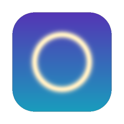

<p align="center">
  
</p>

<h1 align="center">Screendream</h1>

<p align="center">
  <strong>Your music, rendered as worlds.</strong><br>
  An audio-reactive visualizer for macOS
</p>

<p align="center">
  
  
  
  
</p>

Screendream listens to whatever your Mac is playing (Spotify, YouTube, a DJ set, a game) and
turns it into GPU-rendered scenes in real time. It needs no plug-ins and no virtual audio
devices: it captures system audio directly through ScreenCaptureKit.

- 🎧 **Live system audio.** Works with any app that plays sound.
- ⚡ **GPU-rendered.** Every scene is drawn in real time with wgpu on Metal.
- 🎛️ **Five visual modes.** Press <kbd>M</kbd> to switch between them.
- 🔒 **Private by design.** Audio is analysed in memory only. Nothing is ever recorded or transmitted.

---

## Gallery

### Visual modes

| | |
|:---:|:---:|
| <br>**Bubbles**<br><sub>Iridescent bubbles rise through a turquoise Mediterranean sea and refract it like real lenses.</sub> | <br>**Canyon**<br><sub>Fly down a winding planetary canyon whose walls are raised by the music, with a ringed planet and aurora overhead.</sub> |
| <br>**Windmills**<br><sub>Glide over summer farmland where every windmill spins to its own frequency: bass mills are big and stately, treble mills small and quick.</sub> | <br>**Circuits**<br><sub>Eight pens, one per frequency band, etch white-hot fractal traces into a steel plate that folds in 3D.</sub> |
| <br>**Crystal**<br><sub>The original mode: a crystal ringed by orbiting shards, set against a nebula and a spectrum arc.</sub> | |

### Video clips

<!-- To add a clip: drag the .mp4 into this README in GitHub's web editor. GitHub uploads it and
     inserts a playable player link. Alternatively, keep the poster image below and point its
     link at the video file. -->

<p align="center">
  <a href="docs/media/showreel.mp4"></a><br>
  <strong>Showreel</strong>: all five modes cut to one track
</p>

| | |
|:---:|:---:|
| <a href="docs/media/clip-1.mp4"></a><br>**Bubbles on a bass drop** | <a href="docs/media/clip-2.mp4"></a><br>**Canyon fly-through** |

> **Adding media:** the images above are placeholders in `docs/media/`. Save real screenshots
> as PNGs (for example `docs/media/bubbles.png`) and change the `.svg` in the matching `src` to
> `.png`. For videos, save the clip as `docs/media/clip-1.mp4` (and so on) and put a still frame
> in place of its poster image.

---

## Installation

**Requirements:** macOS 14 (Sonoma) or later, on any Mac with Metal (Apple Silicon or Intel).

### Option 1: Install the Mac app

1. Download `Screendream.dmg` from the latest release.
2. Open the DMG and drag **Screendream.app** into `/Applications`.
3. On first launch, if macOS says the app is from an unidentified developer, right-click it,
   choose **Open** and confirm. You only need to do this once.
4. When prompted, grant **Screen & System Audio Recording** access, then relaunch the app.

### Option 2: Run from source

1. Install the Xcode Command Line Tools and stable Rust:

   ```sh
   xcode-select --install
   curl --proto '=https' --tlsv1.2 -sSf https://sh.rustup.rs | sh
   ```

2. Get the code:

   ```sh
   git clone <repository-url> screendream
   cd screendream/screandream_app
   ```

3. Run a release build, which keeps the frame rate smooth:

   ```sh
   cargo run --release
   ```

### Option 3: Build the standalone Mac app

The app bundle is produced by [`cargo-bundle`](https://github.com/burtonageo/cargo-bundle), configured
under `[package.metadata.bundle]` in `Cargo.toml`. The helper script installs it if needed, builds a
release bundle and signs it:

```sh
scripts/bundle-macos.sh          # -> target/release/bundle/osx/Screendream.app
scripts/bundle-macos.sh --dmg    # also -> target/release/Screendream.dmg
```

Launch it with `open target/release/bundle/osx/Screendream.app`, or drag it into `/Applications`.

### Screen & System Audio Recording permission

On first start macOS asks for **Screen & System Audio Recording** access, showing the
`NSScreenCaptureUsageDescription` text. If it was denied, enable Screendream under
*System Settings → Privacy & Security → Screen & System Audio Recording* and relaunch.

The script ad-hoc signs the bundle so macOS remembers the permission between launches on this Mac.
Rebuilding changes the signature, so macOS may ask again after each rebuild.

---

## Controls

| Key | Action |
|:---:|---|
| <kbd>Space</kbd> | Start / stop |
| <kbd>M</kbd> | Next mode |
| <kbd>F</kbd> | Full-screen |
| <kbd>Esc</kbd> | Leave full-screen |
| <kbd>S</kbd> | Open Settings |
| <kbd>Q</kbd> | Quit |

---

## For developers

### What goes into the bundle

| Bundle path                                  | Source                          |
|----------------------------------------------|---------------------------------|
| `Contents/MacOS/screendream`                 | release binary (shaders embedded) |
| `Contents/Resources/assets/default-scene.ply`| `assets/default-scene.ply`      |
| `Contents/Resources/Screendream.icns`        | `resources/icon/icon_*.png`     |
| `Contents/Info.plist`                        | generated + `resources/Info.plist.ext` |

At startup the binary looks for `assets/` in the working directory, then in the bundle's
`Contents/Resources/`, then in the crate root (for `cargo run` from elsewhere).

### Distributing to other Macs

An ad-hoc signed app runs on the Mac that built it; on other Macs Gatekeeper will block it
(right-click → **Open** once to bypass). For proper distribution, sign with a Developer ID
certificate and notarize:

```sh
SIGN_IDENTITY="Developer ID Application: Your Name (TEAMID)" scripts/bundle-macos.sh --dmg
xcrun notarytool submit target/release/Screendream.dmg --keychain-profile <profile> --wait
xcrun stapler staple target/release/Screendream.dmg
```

The bundle targets the architecture of the build machine. For a universal (Apple Silicon + Intel)
app, add both targets and pass them to cargo-bundle:

```sh
rustup target add aarch64-apple-darwin x86_64-apple-darwin
cargo bundle --release --target aarch64-apple-darwin --target x86_64-apple-darwin
```

### Adding a visual mode

Implement the `VisualizerMode` trait in a new file under `src/render/modes/` and register it in
`build_all` in `src/render/modes/mod.rs`.

### Icon

The icon is a generated placeholder. Regenerate it with `python3 scripts/make_icon.py` (no
dependencies), or replace the PNGs in `resources/icon/` with real artwork at the same sizes.

### Tests

```sh
cargo fmt --check
cargo clippy -- -D warnings
cargo test
```
